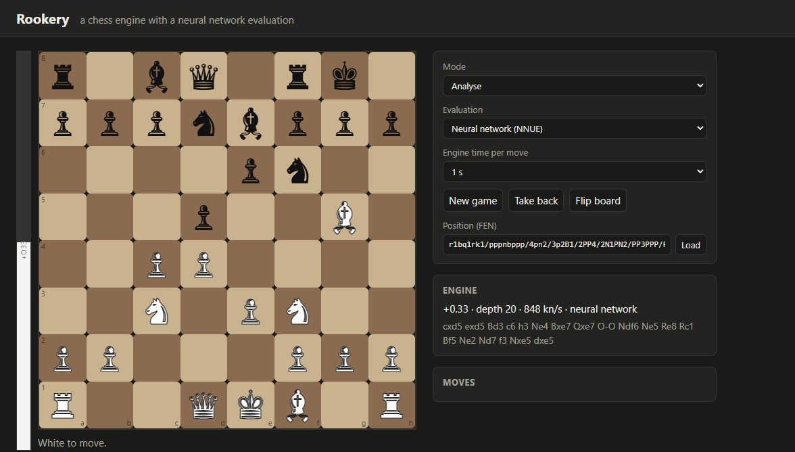

# Rookery

Rookery is a chess engine written from scratch in C++, with two evaluations:

- **a classical one**, built from hand-written terms whose weights are tuned on data;
- **a neural network** (NNUE), trained on 8 million positions evaluated by Stockfish from the open Lichess database.

A web page lets you play against it or analyse with it.



| Part | Language | What it does |
|---|---|---|
| `engine/` | C++20 | Bitboards with magic move generation, alpha-beta search, the two evaluations, and the UCI protocol, so it works in any chess GUI |
| `trainer/` | Python, PyTorch | Prepares the Lichess positions, tunes the classical weights, trains and exports the network |
| `web/` | TypeScript | A Node server that runs the engine, and a page to play against it or analyse with it |
| `scripts/` | Python | Builds balanced opening sets and plays matches with cutechess-cli |

## The engine

**Moves.** Sliding pieces use magic bitboards. The move generator produces pseudo-legal moves and filters them with an exact legality test. It matches the standard perft counts on six reference positions, 41 million leaf nodes in total, and the tests check this.

**Search.**
- Iterative deepening with aspiration windows.
- Principal-variation alpha-beta, plus a quiescence search that skips losing captures by static exchange evaluation (SEE).
- A transposition table with mate scores stored relative to the node.
- Pruning: null-move, reverse futility and futility pruning, late-move reductions and pruning, and internal iterative reductions.
- A check extension.
- Move ordering: hash move, then captures by SEE and most-valuable-victim, killers, then a history table with gravity.

**Classical evaluation.** A linear function of 401 features, each with a middlegame and an endgame weight blended by game phase:

- piece-square tables;
- mobility;
- the bishop pair;
- passed pawns by rank;
- doubled and isolated pawns;
- rooks on open files;
- the king's pawn shield and attacks near the king.

The engine itself writes each training position's feature counts (`rookery features`), so the Python tuner fits exactly what the engine computes.

**Neural evaluation.**
- **Layout:** 768 inputs (piece and colour relative to each side, times square) feed 256 hidden neurons, once per side. The side to move's half and the other half go through SCReLU into a single output.
- **Speed:** the hidden layer is updated incrementally as moves are made and unmade, so a move costs a few hundred additions.
- **Precision:** weights are quantised to 16-bit integers.
- **Faithfulness:** the trainer reproduces the engine's integer arithmetic, and a test checks that the engine gives *exactly* the scores the trainer computed for the exported file.

## Training data

The [Lichess evaluation database](https://database.lichess.org/#evals) is released under CC0 and holds 418 million positions evaluated by Stockfish. Rookery streams the first 12 million positions evaluated to depth 20 or more, without downloading the whole file, and takes the deepest score of each.

**Only quiet positions are used.** A position is left out if the side to move is in check or can win material at once. In such a position, a static evaluation cannot know the score. That leaves 8.08 million of the 12 million positions.

This filter mattered. Before it, about a third of the positions were mid-exchange, and the tuned classical weights rated an extra rook in the middlegame at only +73 centipawns.

| Model | Training positions | Time on an RTX 2060 | Validation loss |
|---|---|---|---|
| Classical weights (Texel tuning, 30 epochs) | 4.0 M | 2.6 min | 0.0106 (material only: 0.0143) |
| Network 768→256×2→1 (12 epochs) | 8.1 M | 6 min | 0.0075 |

The loss is the squared difference between win probabilities, `sigmoid(score / 400)`, the same for both models. The network file is 395 KB.

## Results

### Evaluation accuracy on unseen positions

The test set is 200,000 positions from further into the Lichess database, which neither model saw in training. Of these, 132,611 are quiet. Measured with `rookery evaltest`, output in `results/eval-test.json`:

| | Loss | Mean difference from Stockfish | Right side better (Stockfish ≥ ½ pawn) |
|---|---|---|---|
| Classical | 0.0124 | 134 cp | 82.2% |
| **Neural network** | **0.0095** | **114 cp** | **88.8%** |

### Playing strength

Matches are played with [cutechess-cli](https://github.com/cutechess/cutechess) at 10 s + 0.1 s per game, one thread per engine, 64 MB hash. The 300 openings were made by `scripts/make_openings.py`: random 8-ply openings that Stockfish 19 rates within ±50 cp. Each opening is played twice, once with each colour. Games are adjudicated only when both engines agree. Source: `scripts/match.py`; games are in `results/games/`.

**Neural network against classical evaluation**, the same search otherwise:

| Games | Network wins | Classical wins | Draws | Network's score | Elo difference (95% interval) |
|---|---|---|---|---|---|
| 400 | 252 | 85 | 63 | 70.9% | **+154 ± 34** |

With nothing changed but the evaluation, the network is worth about 150 Elo. Part of that is speed, since the network evaluates faster than the classical terms. Most of it is judgement: the network gets the side that is better right in 89% of positions where Stockfish sees at least half a pawn, against 82% for the classical evaluation.

**Against Stockfish 19 with limited strength** (`UCI_LimitStrength`). Stockfish's source says its `UCI_Elo` setting "covers CCRL Blitz Elo from 1320 to 3190, approximately". Rookery's rating below inherits that approximation, and our games are faster than CCRL Blitz. Take it as a rough placement, not a rating.

| Stockfish `UCI_Elo` | Games | Rookery wins | Losses | Draws | Rookery's score | Rating this match implies |
|---|---|---|---|---|---|---|
| 1500 | 100 | 100 | 0 | 0 | 100% | — |
| 1800 | 100 | 97 | 2 | 1 | 97.5% | 2436 |
| 2100 | 100 | 94 | 4 | 2 | 95% | 2612 |
| 2400 | 100 | 86 | 9 | 5 | 88.5% | 2754 |
| 2700 | 100 | 63 | 29 | 8 | 67% | 2823 |
| 3000 | 100 | 14 | 64 | 22 | 25% | 2809 |
| 3190 | 100 | 2 | 93 | 5 | 4.5% | 2659 |

The maximum-likelihood fit over all 700 games puts Rookery at **2774** on Stockfish's `UCI_Elo` scale (95% interval 2731–2818).

The levels do not agree perfectly. A strength-limited Stockfish loses by deliberately choosing weaker moves, and a solid engine punishes those more often than the Elo model expects, so the levels far from 50% are the least informative. The two closest to an even score, 2700 and 3000, imply about 2810. The 2700 and 3000 levels were added after the first four showed Rookery winning all of them; all 700 games are reported here.

This places Rookery between Stockfish's 2700 and 3000 settings at a fast time control. It is not a CCRL rating: no games were played against rated engines under CCRL conditions.

**Speed.** With the network, the engine searches about 1.2 million nodes a second on one core of a laptop CPU (`rookery bench`, build with `-DROOKERY_NATIVE=ON`), against 0.97 million with the classical evaluation. The network is faster because it is updated incrementally, while the classical terms are computed afresh at every node.

**Limits.**
- One search thread.
- No endgame tablebases and no opening book.
- The network is small, with no king buckets or extra layers, and is trained once on Stockfish scores rather than on its own games.
- The classical weights still undervalue large material leads: the loss compresses big scores, and Lichess positions rarely have them.

## Running it

What you need:

- CMake and a C++20 compiler (GCC, Clang or MSVC);
- Python 3.14 with an NVIDIA GPU for training;
- Node 24 for the web page.

```bash
cmake -S engine -B engine/build -G Ninja -DROOKERY_NATIVE=ON && cmake --build engine/build
engine/build/rookery bench 10              # or plug engine/build/rookery into any UCI chess GUI
cd web && npm install && npm run build && npm start      # http://localhost:3021
```

The trained network `nets/rookery.nnue` is in the repository; the build copies it next to the engine. To train from scratch:

```bash
scripts/fetch-deps.sh --data                 # cutechess-cli, Stockfish 19, 12 M Lichess positions
cd trainer && python -m venv .venv && .venv/Scripts/pip install -r requirements.txt --index-url https://download.pytorch.org/whl/cu128 --extra-index-url https://pypi.org/simple
../engine/build/rookery features ../data/evals.csv ../data/features.bin 4000000
.venv/Scripts/python -m rookery_train.tune_classical ../data/features.bin --epochs 30 --lr 5     # writes engine/src/eval_weights.h
../engine/build/rookery positions ../data/evals.csv ../data/positions.bin
.venv/Scripts/python -m rookery_train.train_nnue ../data/positions.bin                           # writes nets/
cd .. && python scripts/make_openings.py && python scripts/match.py nnue-vs-classical && python scripts/match.py stockfish
```

## Tests

| Part | Tests | What they cover |
|---|---|---|
| C++ | 9 | perft on six reference positions; FEN round trips; incremental hashing against recomputation; draws (repetition, fifty moves, insufficient material); the network against the trainer's numbers, exactly; incremental network updates against fresh computation through castling, en passant and promotions; evaluation symmetry; mates in one and two, winning a hanging queen, stalemate; node limits |
| Python | 7 | feature indexing and mirroring; the integer arithmetic against the float network; the file format; the data readers |
| TypeScript | 6 | reading UCI output; scores from White's view |

CI builds and tests the engine with GCC on Ubuntu and MSVC on Windows.

## Licences

| What | Licence |
|---|---|
| Rookery | MIT |
| Lichess evaluation database | CC0 |
| chess.js (rules in the web page) | BSD-2-Clause |
| Stockfish and cutechess | GPL-3.0; used only as an opponent and a match runner, downloaded by `scripts/fetch-deps.sh`, never shipped with Rookery |
